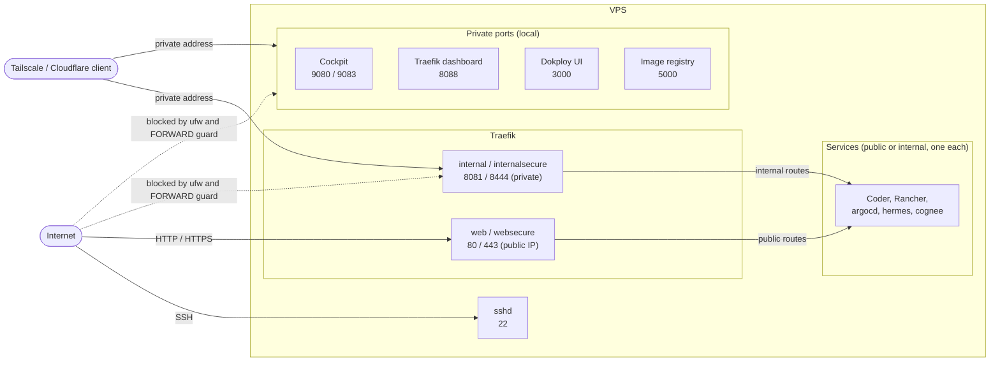

<!-- @format -->

# vps

Turn a fresh Ubuntu VPS into a secured management box with one command. It
hardens the server, joins it to your private network and installs Cockpit, k3s,
Rancher and a catalog of ready-to-install apps. Every step is idempotent: re-run
it at any time, and take any step down again without touching the others.

## Quick start

As root on a fresh Ubuntu VPS:

```bash
curl -fsSL https://raw.githubusercontent.com/tomgrv/scripts/main/setup.sh | sh
zz-use perspikapps/vps/vps-setup
sudo vps-setup
```

On a terminal, `vps-setup` opens a menu to pick steps and fill in the inputs.
For an unattended run, pass the inputs as variables:

```bash
sudo VPS_ADMIN_USER=ops \
    VPS_ADMIN_SSH_KEY="ssh-ed25519 AAAA... you@laptop" \
    TAILSCALE_AUTHKEY="tskey-auth-..." \
    RANCHER_HOSTNAME="rancher.tailnet-name.ts.net" \
    vps-setup
```

This creates the `ops` sudo user with your key, disables SSH password login,
joins your Tailscale network, and installs Cockpit, k3s and Rancher. From a
machine on the same tailnet, open Cockpit at `https://<tailscale-ip>:9080` and
Rancher at the host its step prints. The generated passwords are printed
at the end and saved in `/root/.vps-secrets.env`. `vps-setup -h` lists every flag.

## Steps

Steps run in this order. Each has its own README with its variables.

| Step                                           | What it does                                                         | Default |
| ---------------------------------------------- | -------------------------------------------------------------------- | ------- |
| [`vps-system`](vps-system/README.md)           | System update, base tools, unattended security upgrades              | on      |
| [`vps-tailscale`](vps-tailscale/README.md)     | Installs Tailscale and joins your tailnet (the private network)      | on      |
| [`vps-cloudflare`](vps-cloudflare/README.md)   | Cloudflare Tunnel + WARP as the private network instead of Tailscale | opt-in  |
| [`vps-security`](vps-security/README.md)       | Admin user, firewall, SSH hardening, fail2ban, Cockpit login         | on      |
| [`vps-access`](vps-access/README.md)           | Confirms public/internal visibility per service and the DNS domains  | on      |
| [`vps-cockpit`](vps-cockpit/README.md)         | Cockpit web console                                                  | on      |
| [`vps-k3s`](vps-k3s/README.md)                 | k3s, kubectl, Helm and Traefik as the public HTTP/HTTPS ingress      | on      |
| [`vps-rancher`](vps-rancher/README.md)         | cert-manager and Rancher                                             | on      |
| [`vps-dokploy`](vps-dokploy/README.md)         | Dokploy, an alternative to the k3s stack                             | opt-in  |
| [`vps-marketplace`](vps-marketplace/README.md) | Registers the [app catalog](#app-catalog) in Rancher                 | on      |
| [`vps-coder`](vps-coder/README.md)             | Coder cloud development environments (needs Rancher)                 | opt-in  |

Choose what runs with flags, or with the menu:

```bash
sudo vps-setup --skip-vps-cockpit               # everything except Cockpit
sudo vps-setup --with-vps-coder                 # also run an opt-in step
sudo vps-setup --only-vps-rancher               # just this step (e.g. after changing a variable)
sudo vps-setup --skip-vps-tailscale --with-vps-cloudflare   # Cloudflare instead of Tailscale
sudo vps-setup --skip-vps-k3s --skip-vps-rancher --skip-vps-marketplace --with-vps-dokploy   # Dokploy instead of k3s
```

A step's dependencies are enabled for you (`--only-vps-marketplace` also runs
`vps-rancher` and `vps-k3s`). Tailscale and Cloudflare cannot run together, nor
can k3s and Dokploy: `vps-setup` stops before running anything if you select both.

## Remove a step

```bash
sudo vps-setup --down-vps-marketplace
sudo vps-setup --down-vps-k3s --down-vps-rancher --down-vps-marketplace   # the whole cluster
```

A step is refused while something that depends on it is still enabled; bring
the dependents down in the same run, or add `--force-down`. Removing `vps-k3s`
takes Rancher and every app installed from the catalog with it; removing
`vps-dokploy` takes every app it deployed. Each step's README lists what its
`down` removes and keeps.

## Inputs

Pass them as environment variables on the `sudo` line (`sudo VAR=... vps-setup`;
`export` alone is lost by `sudo`). The menu asks for the ones the selected steps
need and remembers your answers in `/etc/vps.env`.

| Variable                     | Default                  | Purpose                                                                      |
| ---------------------------- | ------------------------ | ---------------------------------------------------------------------------- |
| `VPS_ADMIN_USER`             | unset                    | Create this sudo user                                                        |
| `VPS_ADMIN_SSH_KEY`          | unset                    | Authorized SSH key for the admin user and root                               |
| `VPS_ADMIN_PASSWORD`         | random                   | Cockpit/console password (SSH stays key-only)                                |
| `SSH_PORT`                   | `22`                     | SSH port kept open publicly                                                  |
| `TAILSCALE_AUTHKEY`          | none                     | **Required** with `vps-tailscale` (or pass `--skip-vps-tailscale`)           |
| `CLOUDFLARE_TUNNEL_TOKEN`    | none                     | **Required** with `vps-cloudflare`                                           |
| `VPS_PRIVATE_INTERFACE`      | `tailscale0`             | Private network interface, e.g. `wg0` when you bring your own                |
| `RANCHER_HOSTNAME`           | private IP, else node IP | Hostname in Rancher's certificate                                            |
| `RANCHER_BOOTSTRAP_PASSWORD` | random                   | Rancher `admin` initial password                                             |
| `TRAEFIK_ACME_EMAIL`         | placeholder              | Let's Encrypt contact email: set a real one                                  |
| `TRAEFIK_ACME_STAGING`       | `true`                   | `false` for trusted Let's Encrypt certificates                               |
| `WILDCARD_DOMAIN`            | nip.io fallback          | Wildcard DNS domain for apps that need subdomains                            |
| `<NAME>_PORT`                | per step                 | Override a port for one run, e.g. `COCKPIT_HTTPS_PORT`, `TRAEFIK_INTERNAL_HTTPS_PORT` |

To keep a set of inputs in a file instead, use `/etc/vps-setup.env`
(`KEY=VALUE`, or the file named by `VPS_SETUP_ENV_FILE`); it is read on every
run and wins over `/etc/vps.env`.

### Getting the keys

- **SSH key** (`VPS_ADMIN_SSH_KEY`): generate it on your own machine,
  `ssh-keygen -t ed25519 -C "you@laptop"`, and paste the whole `.pub` line. Your
  GitHub keys are at `https://github.com/<you>.keys`.
- **Tailscale auth key** (`TAILSCALE_AUTHKEY`): create it at
  <https://login.tailscale.com/admin/settings/keys>. For a server choose
  reusable, not ephemeral, pre-approved if your tailnet requires approval, with
  a short expiry. Without it Tailscale is still installed; run `tailscale up`
  yourself afterwards.
- **Rancher password** (`RANCHER_BOOTSTRAP_PASSWORD`): any string, for example
  `openssl rand -base64 24`. Left unset, one is generated.

## What is reachable

From the internet: SSH, and HTTP/HTTPS through Traefik. Cockpit, the
Traefik dashboard, the Dokploy UI and the k3s API only answer on your private
network, so join the same tailnet first. To check from outside,
`curl -m 5 http://<public-ip>:9083` must time out.

The [`vps-access`](vps-access/README.md) step confirms each service's choice (and the DNS domains) on a terminal.

Every service is reachable one of three ways. Coder, Rancher and the apps pick
**public or internal, never both**; the private ports are a separate, local access.



| Access   | Reached on                              | Chosen by                                     |
| -------- | --------------------------------------- | --------------------------------------------- |
| public   | server IP: Traefik 80/443 (Dokploy's Traefik uses the same ports), SSH 22 | default; `RANCHER_ACCESS`, `CODER_ACCESS`, chart `ingress.access` |
| internal | Tailscale/Cloudflare address, Traefik 8081/8444 | `internal` in those same settings             |
| private  | Tailscale/Cloudflare address, own ports | always, for `access: "private"` steps         |

- **Logins.** Cockpit uses a Linux account (`VPS_ADMIN_USER`, else `root`) and
  the password from `VPS_ADMIN_PASSWORD` or the generated one. Rancher uses
  `admin` and asks you to change the password at first login.
- **Websites.** Traefik serves any hostname pointed at the VPS, from the
  `Ingress` that declares it. To get a Let's Encrypt certificate, annotate the
  `Ingress` with `traefik.ingress.kubernetes.io/router.tls.certresolver: letsencrypt`.
  Certificates are staging ones until you set `TRAEFIK_ACME_STAGING=false`.
- **Traefik dashboard.** `http://<private-ip>:8088/dashboard/` (trailing slash
  required), private network only.

## App catalog

`vps-marketplace` adds this repo's catalog to Rancher under **Apps &
Marketplace → Repositories** (`https://perspikapps.github.io/vps/`). Install apps
from **Apps & Marketplace → Charts**; each chart's README lists the values to fill in.

| App                                       | What it is                         |
| ----------------------------------------- | ---------------------------------- |
| [ArgoCD](charts/argocd/README.md)         | GitOps continuous delivery         |
| [Coder](charts/coder/README.md)           | Cloud development environments     |
| [Cognee](charts/cognee/README.md)         | AI memory and knowledge graph      |
| [Epinio](charts/epinio/README.md)         | Push source code to deploy apps    |
| [GitHub ARC](charts/github-arc/README.md) | Self-hosted GitHub Actions runners |
| [Hermes Agent](charts/hermes/README.md)   | Self-improving AI agent            |
| [Infisical](charts/infisical/README.md)   | Secrets management                 |

## Provision at first boot

[`cloud-init/kairos-vps-setup.yaml`](cloud-init/README.md) runs `vps-setup`
unattended on first boot, on any cloud-init provider (DigitalOcean, Hetzner,
OpenStack...) or [Kairos](https://kairos.io) image. Fill in the placeholders
(SSH key, Tailscale key, `RANCHER_HOSTNAME`), paste it into the provider's "User
data" field, and follow progress in `/var/log/vps-setup.log`.

## Troubleshooting

- **A step fails.** `vps-setup` stops at the first failing step and prints the
  command to re-run just that step, for example `sudo vps-setup --only-vps-rancher`.
- **A step stops without output.** A prerequisite was probably skipped, for
  example `--only-vps-rancher` on a box where `vps-k3s` never ran. Run the
  missing step first.
- **`command not found` after an upgrade.** Refresh the cached copy:
  `sudo zz-use --force perspikapps/vps/vps-setup`.
- **Test a branch or fork.** Fetch it and point `vps-setup` at the same ref:

    ```bash
    zz-use "perspikapps/vps/vps-setup@my-branch"
    sudo ZZ_SETUP_REF=my-branch vps-setup      # fork: add VPS_SETUP_REPO_URL=https://github.com/<you>/vps.git
    ```

## Contributing

Each step is a top-level `vps-*` folder (`run.sh`, `package.json`, `README.md`,
`test.bats`); its `package.json` declares the order, dependencies, inputs and
ports. Run the tests with `npm test`. Breaking changes: [`UPGRADING.md`](UPGRADING.md).
