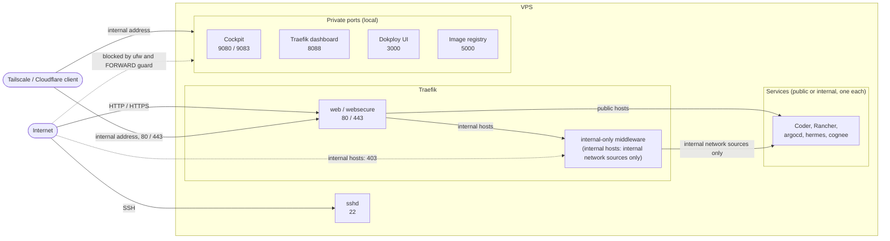

<!-- @format -->

# vps

Turn a fresh Ubuntu VPS into a secured management box with one command. It
hardens the server, joins it to your internal network and installs Cockpit, k3s,
Rancher and a catalog of ready-to-install apps. Every step is idempotent: re-run
it at any time, and take any step down again without touching the others.

**Start here**

- Install: [Quick start](#quick-start), or [provision at first boot](#provision-at-first-boot).
- Choose what runs: [Steps](#steps) and [Remove a step](#remove-a-step).
- Configure: [Inputs](#inputs) and [where state lives](#where-state-lives).
- Reach your services: [What is reachable](#what-is-reachable) (public, internal, local).
- Add apps: [Apps](#apps) and [Rancher Marketplace](#rancher-marketplace).
- Something wrong: [Troubleshooting](#troubleshooting).
- Change or add a step: [Contributing](#contributing).

## Quick start

As root on a fresh Ubuntu VPS:

```bash
curl -fsSL https://raw.githubusercontent.com/tomgrv/scripts/main/setup.sh | sh
zz-use perspikapps/vps/vps-setup
sudo vps-setup
```

On a terminal, `vps-setup` opens a menu to pick steps and fill in the inputs.
For an unattended run, pass the inputs as variables:

```bash
sudo SYSTEM_ADMIN_USER=ops \
    SYSTEM_ADMIN_SSH_KEY="ssh-ed25519 AAAA... you@laptop" \
    TAILSCALE_AUTHKEY="tskey-auth-..." \
    SYSTEM_INTERNAL_APPS="rancher" \
    vps-setup
```

This creates the `ops` sudo user with your key, disables SSH password login,
joins your Tailscale network, and installs Cockpit, k3s and Rancher. From a
machine on the same tailnet, open Cockpit at `https://<tailscale-ip>:9080` and
Rancher at the host its step prints. The generated passwords are printed
at the end and saved in `/root/.vps-secrets.env`. `vps-setup -h` lists every flag.

## Steps

Steps run in this order. Each has its own README with its variables.

Naming: `vps-*` are system steps (their variables are `SYSTEM_<VAR>`), `svc-*` services installed as packages or binaries (`<SERVICE>_<VAR>`, e.g. `TAILSCALE_AUTHKEY`), and `app-*` Helm charts (`<APP>_<VAR>`).

| Step                                         | What it does                                                          | Default |
| -------------------------------------------- | --------------------------------------------------------------------- | ------- |
| [`vps-system`](vps-system/README.md)         | System update, base tools, unattended security upgrades               | on      |
| [`svc-tailscale`](svc-tailscale/README.md)   | Installs Tailscale and joins your tailnet (the internal network)      | on      |
| [`svc-cloudflare`](svc-cloudflare/README.md) | Cloudflare Tunnel + WARP as the internal network instead of Tailscale | opt-in  |
| [`vps-security`](vps-security/README.md)     | Admin user, firewall, SSH hardening, fail2ban, Cockpit login          | on      |
| [`vps-access`](vps-access/README.md)         | Confirms public/internal visibility per service and the DNS domains   | on      |
| [`svc-cockpit`](svc-cockpit/README.md)       | Cockpit web console                                                   | on      |
| [`svc-k3s`](svc-k3s/README.md)               | k3s, kubectl, Helm and Traefik as the public HTTP/HTTPS ingress       | on      |
| [`app-rancher`](app-rancher/README.md)       | cert-manager and Rancher                                              | on      |
| [`vps-dokploy`](vps-dokploy/README.md)       | Dokploy, an alternative to the k3s stack                              | opt-in  |
| [`app-coder`](app-coder/README.md)           | Coder cloud development environments (needs Rancher)                  | opt-in  |
| [`app-argocd`](app-argocd/README.md)         | ArgoCD, GitOps continuous delivery (see [apps](#apps))                | opt-in  |
| [`app-cognee`](app-cognee/README.md)         | Cognee, AI memory and knowledge graph                                 | opt-in  |
| [`app-hermes`](app-hermes/README.md)         | Hermes Agent, a self-improving AI agent                               | opt-in  |
| [`app-epinio`](app-epinio/README.md)         | Epinio, push source code to deploy apps                               | opt-in  |
| [`app-github-arc`](app-github-arc/README.md) | Self-hosted GitHub Actions runners                                    | opt-in  |
| [`app-infisical`](app-infisical/README.md)   | Infisical, secrets management                                         | opt-in  |

Choose what runs with flags, or with the menu:

```bash
sudo vps-setup --skip-svc-cockpit               # everything except Cockpit
sudo vps-setup --with-app-coder                 # also run an opt-in step
sudo vps-setup --only-app-rancher               # just this step (e.g. after changing a variable)
sudo vps-setup --skip-svc-tailscale --with-svc-cloudflare   # Cloudflare instead of Tailscale
sudo vps-setup --skip-svc-k3s --skip-app-rancher --with-vps-dokploy   # Dokploy instead of k3s
```

A step's dependencies are enabled for you (`--only-app-argocd` also runs
`svc-k3s`). Tailscale and Cloudflare cannot run together, nor
can k3s and Dokploy: `vps-setup` stops before running anything if you select both.

## Remove a step

```bash
sudo vps-setup --down-app-argocd
sudo vps-setup --down-svc-k3s --down-app-rancher   # the whole cluster (apps go with k3s)
```

A step is refused while something that depends on it is still enabled; bring
the dependents down in the same run, or add `--force-down`. Removing `svc-k3s`
takes Rancher and every app installed from the catalog with it; removing
`vps-dokploy` takes every app it deployed. Each step's README lists what its
`down` removes and keeps.

## Inputs

Pass them as environment variables on the `sudo` line (`sudo VAR=... vps-setup`;
`export` alone is lost by `sudo`). The menu asks for the ones the selected steps
need and remembers your answers in `/etc/vps.env`.

| Variable                                      | Default                                  | Purpose                                                                             |
| --------------------------------------------- | ---------------------------------------- | ----------------------------------------------------------------------------------- |
| `SYSTEM_ADMIN_USER`                           | unset                                    | Create this sudo user                                                               |
| `SYSTEM_ADMIN_SSH_KEY`                        | unset                                    | Authorized SSH key for the admin user and root                                      |
| `SYSTEM_ADMIN_PASSWORD`                       | random                                   | Cockpit/console password (SSH stays key-only)                                       |
| `SYSTEM_SSH_PORT`                             | `22`                                     | SSH port kept open publicly                                                         |
| `TAILSCALE_AUTHKEY`                           | none                                     | **Required** with `svc-tailscale` (or pass `--skip-svc-tailscale`)                  |
| `CLOUDFLARE_TUNNEL_TOKEN`                     | none                                     | **Required** with `svc-cloudflare`                                                  |
| `SYSTEM_INTERNAL_INTERFACE`                   | set by Tailscale/Cloudflare, else a menu | Internal network interface, e.g. `wg0` when you bring your own                      |
| `SYSTEM_INTERNAL_DOMAIN`                      | the external domain                      | Domain internal services are reached on                                             |
| `SYSTEM_INTERNAL_APPS` / `SYSTEM_PUBLIC_APPS` | per-app default                          | Comma lists of the apps served on the internal / public network (unattended runs)   |
| `ZZ_INTERACTIVE`                              | auto                                     | `0` never asks (no menu, no prompt); otherwise a terminal is used when there is one |
| `ZZ_SECRETS_FILE`                             | `/root/.vps-secrets.env`                 | Owner-only file holding the generated credentials                                   |
| `RANCHER_BOOTSTRAP_PASSWORD`                  | random                                   | Rancher `admin` initial password                                                    |
| `K3S_TRAEFIK_ACME_EMAIL`                      | placeholder                              | Let's Encrypt contact email: set a real one                                         |
| `K3S_TRAEFIK_ACME_STAGING`                    | `true`                                   | `false` for trusted Let's Encrypt certificates                                      |
| `SYSTEM_EXTERNAL_DOMAIN`                      | nip.io fallback                          | Wildcard DNS domain for apps that need subdomains                                   |
| `<NAME>_PORT`                                 | per step                                 | Override a port for one run, e.g. `COCKPIT_HTTPS_PORT`                              |

To keep a set of inputs in a file instead, use `/etc/vps-setup.env`
(`KEY=VALUE`, or the file named by `VPS_SETUP_ENV_FILE`); it is read on every
run and wins over `/etc/vps.env`.

### Getting the keys

- **SSH key** (`SYSTEM_ADMIN_SSH_KEY`): generate it on your own machine,
  `ssh-keygen -t ed25519 -C "you@laptop"`, and paste the whole `.pub` line. Your
  GitHub keys are at `https://github.com/<you>.keys`.
- **Tailscale auth key** (`TAILSCALE_AUTHKEY`): create it at
  <https://login.tailscale.com/admin/settings/keys>. For a server choose
  reusable, not ephemeral, pre-approved if your tailnet requires approval, with
  a short expiry. Without it Tailscale is still installed; run `tailscale up`
  yourself afterwards.
- **Rancher password** (`RANCHER_BOOTSTRAP_PASSWORD`): any string, for example
  `openssl rand -base64 24`. Left unset, one is generated.

## What is reachable

From the internet: SSH, and HTTP/HTTPS through Traefik. Cockpit, the
Traefik dashboard, the Dokploy UI and the k3s API only answer on your internal
network, so join the same tailnet first. To check from outside,
`curl -m 5 http://<public-ip>:9083` must time out.

The [`vps-access`](vps-access/README.md) step confirms each service's choice (and the DNS domains) on a terminal.

Every service is reachable one of three ways. Coder, Rancher and the apps pick
**public or internal, never both**; the private ports are a separate, local access.



| Access   | Reached on                                                                  | Chosen by                                                              |
| -------- | --------------------------------------------------------------------------- | ---------------------------------------------------------------------- |
| public   | server IP: Traefik 80/443 (Dokploy's Traefik uses the same ports), SSH 22   | default; the system config: `vps-access` menu, `SYSTEM_PUBLIC_APPS`    |
| internal | Tailscale/Cloudflare address, Traefik 80/443, internal network sources only | `internal` in the system config (`vps-access`, `SYSTEM_INTERNAL_APPS`) |
| private  | Tailscale/Cloudflare address, own ports                                     | always, for `access: "private"` steps                                  |

- **Logins.** Cockpit uses a Linux account (`SYSTEM_ADMIN_USER`, else `root`) and
  the password from `SYSTEM_ADMIN_PASSWORD` or the generated one. Rancher uses
  `admin` and asks you to change the password at first login.
- **Websites.** Traefik serves any hostname pointed at the VPS, from the
  `Ingress` that declares it. To get a Let's Encrypt certificate, annotate the
  `Ingress` with `traefik.ingress.kubernetes.io/router.tls.certresolver: letsencrypt`.
  Certificates are staging ones until you set `K3S_TRAEFIK_ACME_STAGING=false`.
- **Traefik dashboard.** `http://<internal-ip>:8088/dashboard/` (trailing slash
  required), internal network only.

## Apps

Each app is an opt-in `app-*` step that installs this repo's chart (`charts/<app>`) with
`helm`, through the shared [`app-helm`](app-helm/README.md): `sudo vps-setup --with-app-argocd`.
Apps with their own ingress templates (ArgoCD, Cognee, Hermes, Coder) are **public or internal**
(see [`vps-access`](vps-access/README.md)); Epinio and Infisical bring their own ingress and are
public-only. The steps ask for what the app needs (`COGNEE_LLM_API_KEY`, `HERMES_IMAGE_REPOSITORY`,
the GitHub App for ARC...); each README lists them.

## Rancher Marketplace

The same charts are published as a Helm repository (`https://perspikapps.github.io/vps/`). To
install one from Rancher's UI instead, add it under **Apps & Marketplace → Repositories** by hand,
then pick the chart under **Charts**; each chart's README lists the values to fill in.

| App                                       | What it is                         | Step                                         |
| ----------------------------------------- | ---------------------------------- | -------------------------------------------- |
| [ArgoCD](charts/argocd/README.md)         | GitOps continuous delivery         | [`app-argocd`](app-argocd/README.md)         |
| [Coder](charts/coder/README.md)           | Cloud development environments     | [`app-coder`](app-coder/README.md)           |
| [Cognee](charts/cognee/README.md)         | AI memory and knowledge graph      | [`app-cognee`](app-cognee/README.md)         |
| [Epinio](charts/epinio/README.md)         | Push source code to deploy apps    | [`app-epinio`](app-epinio/README.md)         |
| [GitHub ARC](charts/github-arc/README.md) | Self-hosted GitHub Actions runners | [`app-github-arc`](app-github-arc/README.md) |
| [Hermes Agent](charts/hermes/README.md)   | Self-improving AI agent            | [`app-hermes`](app-hermes/README.md)         |
| [Infisical](charts/infisical/README.md)   | Secrets management                 | [`app-infisical`](app-infisical/README.md)   |

## Provision at first boot

[`cloud-init/kairos-vps-setup.yaml`](cloud-init/README.md) runs `vps-setup`
unattended on first boot, on any cloud-init provider (DigitalOcean, Hetzner,
OpenStack...) or [Kairos](https://kairos.io) image. Fill in the placeholders
(SSH key, Tailscale key, `SYSTEM_INTERNAL_APPS`), paste it into the provider's "User
data" field, and follow progress in `/var/log/vps-setup.log`.

## Troubleshooting

- **A step fails.** `vps-setup` stops at the first failing step and prints the
  command to re-run just that step, for example `sudo vps-setup --only-app-rancher`.
- **A step stops without output.** A prerequisite was probably skipped, for
  example `--only-app-rancher` on a box where `svc-k3s` never ran. Run the
  missing step first.
- **`command not found` after an upgrade.** Refresh the cached copy:
  `sudo zz-use --force perspikapps/vps/vps-setup`.
- **Test a branch or fork.** Fetch it and point `vps-setup` at the same ref:

    ```bash
    zz-use "perspikapps/vps/vps-setup@my-branch"
    sudo ZZ_SETUP_REF=my-branch vps-setup      # fork: add VPS_SETUP_REPO_URL=https://github.com/<you>/vps.git
    ```

## Where state lives

| File                     | Holds                                                                          | Written by                  |
| ------------------------ | ------------------------------------------------------------------------------ | --------------------------- |
| `/etc/vps-setup.env`     | your settings, shell syntax, read on every run (cloud-init writes it)          | you                         |
| `/etc/vps.env`           | answers typed in the menu and each step's remembered state (`ZZ_STATE_<step>`) | `zz-setup`                  |
| `/etc/vps-network.env`   | internal interface and range, external/internal domain, per-app visibility     | `vps-network`, `vps-access` |
| `/root/.vps-secrets.env` | generated passwords and keys (mode 600)                                        | `zz-persist -S`             |

Reset one of them by deleting its file (or a key from it); steps never edit the
settings file. `ZZ_INTERACTIVE=0` keeps every menu off for unattended runs.

## Contributing

Layout: one top-level folder per step, named `vps-*` (system), `svc-*` (a
service installed as package or binary) or `app-*` (a Helm chart from
[`charts/`](charts)). `vps-network`, `app-helm` and `app-cert-manager` are
scripts shared by the steps, not steps.

A step is `run.sh` (functions `up`, `down`, optional `summary`, ending with
`. zz-step`), `package.json`, `README.md` and `test.bats`. Its `package.json`
declares what `zz-setup` needs:

| Field                              | Meaning                                                                                |
| ---------------------------------- | -------------------------------------------------------------------------------------- |
| `engines.zz-setup`                 | marks the folder as a step                                                             |
| `config.order`, `config.default`   | run order, and whether it is on by default                                             |
| `config.conflicts`, `dependencies` | steps that cannot run together; steps that must be enabled with it                     |
| `config.requires`                  | `{"root": true, "os": "ubuntu"}`, checked before it runs                               |
| `config.inputs`                    | variables the step reads (`description`, `default`, `required`, `secret`)              |
| `config.ports`                     | ports it opens: `access: public` to everyone, `private` only on the internal interface |
| `config.visibility`                | `public` or `internal` default of an app that serves a route                           |
| `config.summary`                   | `true` when `summary` prints connection details                                        |

Rules that keep the steps consistent: variables are `SYSTEM_<VAR>`,
`<SERVICE>_<VAR>` or `<APP>_<VAR>`; `down` removes what `up` installed and never
fails on something already gone; helpers (`systemd-service`, `kube-apply`,
`helm-install`, `zz-persist -S`) come from [`tomgrv/scripts`](https://github.com/tomgrv/scripts)
and are listed in the `zz-use` line at the top of `run.sh`.

Run it:

```sh
sudo zz-setup ./ -o app-rancher     # one step from a checkout (zz-setup puts the steps' bins on PATH)
sudo zz-setup ./ -S                 # states and inputs of every step, runs nothing
npm test                            # every suite (bats-core): static checks, plus stubs for kubectl/helm
```

The tests need the `tomgrv/scripts` tools (`zz-log`, `zz-args`, `zz-persist`, ...)
on `PATH`: install them with `zz-use`, or symlink each `*/run.sh` of that
repository under its folder name. They are not run by a workflow yet.
Breaking changes: [`UPGRADING.md`](UPGRADING.md).
